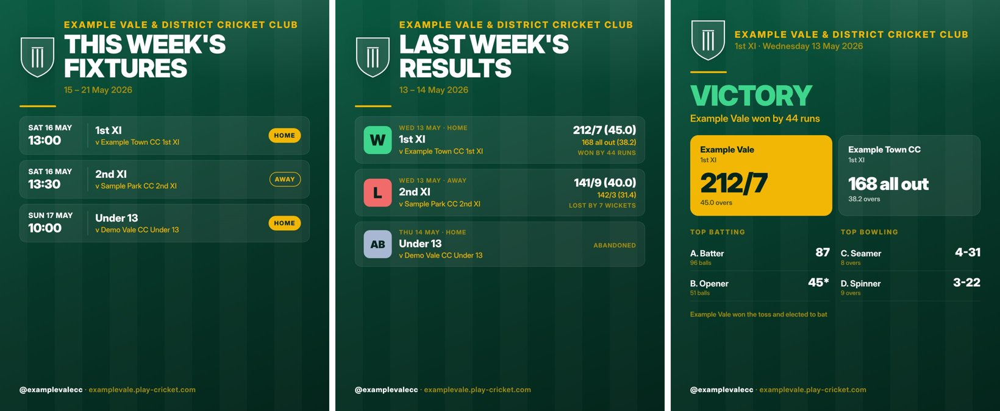

# Cricket Social Kit

Automatic, club-branded **Facebook and Instagram posts from your Play-Cricket results and fixtures**.
It's free to run and needs no coding to set up.



*Example graphics for a made-up club. Yours use your own badge, colours and name.*

## What it does

| Post | When | What's on it |
|---|---|---|
| **Match result** | every morning | each match played yesterday: result, scores, top batting and bowling |
| **Fixtures** | once a week (you choose the day) | every fixture in the next 7 days, home or away |
| **Results round-up** | once a week (you choose the day) | every result from the last 7 days |

- **You approve every post.** Each one arrives on your phone (through the free GitHub app) with
  its graphic and caption. Edit the words if you like, tap to approve, and it's posted. You can
  switch to fully automatic posting later.
- **Safe for juniors.** Every player is shown as first name and initial ("Ben T.") in every team,
  because juniors often play in adult sides. Clubs can choose no names, or full names for adult teams.
- **Your branding.** Your badge, your two club colours, your name, handle and hashtags.
- **Free.** It runs on GitHub Actions' free allowance and posts directly through Meta. No paid
  scheduling tool is needed.

## Getting started

Follow the **[setup guide](docs/SETUP.md)**. In short:

1. Click **Use this template** to make your club's own copy (keep it **public**).
2. Upload your badge and fill in `club.yml`: your name, Play-Cricket Site ID and colours.
3. Ask Play-Cricket for your club's free **API token** and save it as a secret.
4. Connect your Facebook Page and Instagram once, using a Meta token, saved as a secret.
5. Run **Check setup** from the Actions tab and look at the preview it opens.

## How it works

- Every morning a GitHub Actions workflow reads your club's data with Play-Cricket's API, using
  your club's own token, as Play-Cricket recommends.
- It draws the graphics (1080×1350 JPEG, the size Instagram prefers), saves them in the
  repository, and opens an issue for each post.
- Adding the **approved** label to an issue posts it to Facebook and Instagram through Meta's
  Graph API, then closes the issue with links to the posts.

```
club.yml               your club's settings
assets/                your badge
kit/                   the code and graphic templates
posts/                 graphics the kit has made
state/posted.json      which posts have been made (so nothing is posted twice)
.github/workflows/     the schedule, the approval step and the setup check
```

## For developers

```
pip install -r requirements.txt && python -m playwright install chromium
python -m pytest tests                # tests use made-up data in Play-Cricket's API format
python -m kit make --today 2026-06-01 # needs PLAYCRICKET_API_TOKEN
```

Data comes from the Play-Cricket API v2 (`matches.json`, `result_summary.json`, `match_detail.json`).
Posting uses the Meta Graph API (`/{page}/photos`, `/{page}/feed`, `/{ig-user}/media`,
`/{ig-user}/media_publish`).

## Credits and licence

First built for Verwood Cricket Club. The graphics use the Inter typeface (SIL Open Font
Licence, see `kit/fonts/LICENSE-Inter.txt`). The kit's code is released under the MIT licence (see `LICENSE`).
